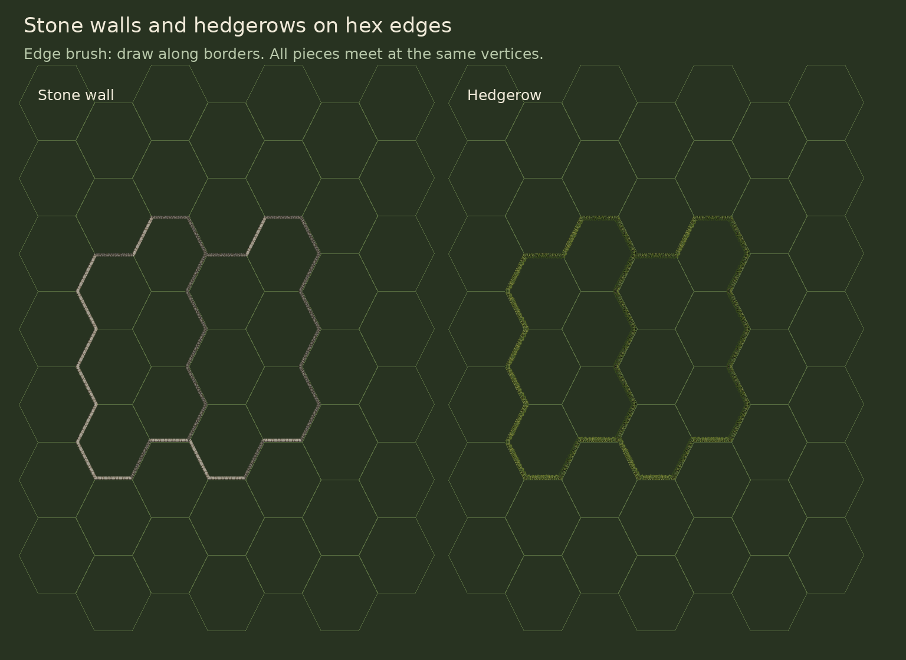

# Stone walls and hedgerows on hex edges



All eight map wall layers reuse
`scenes/world/maps/layers/wall_tile_map_layer.tscn` and
`resources/tilesets/walls.tres`. Walls and hedges lie on hex sides, exactly like
the legacy edge pieces. Hex interiors stay open.

## Draw in the designer

1. Select **WallTileMapLayer** in the scene tree.
2. Enable **Paint hex edges** in the 2D toolbar.
3. Choose **Stone wall** or **Hedge**, then click or drag along hex borders.
4. Choose **Erase edge**, or drag with the right mouse button, to remove sides.
5. Use normal editor undo/redo to restore a stroke.

The brush highlights the selected border, snaps to its nearest side and chooses
the matching corner or multi-side piece. It uses one owner for a shared side,
so straying across the border cannot create a doubled wall. Existing copies on
the opposite side are removed as part of the same undoable stroke.

Each style contains all 63 nonempty combinations of the six hex sides. You can
also select pieces directly from **Tiles → Stone Wall Edges / Hedge Edges**.
There is no center-linking terrain brush. A tile's sides use one material;
changing that tile's material keeps its edge footprint. Stone and hedge pieces
can meet at shared vertices across different tiles.

Only selected sides provide cover or block LOS. Stone wall cover is 2 and hedge
cover is 1. The directional `n`, `ne`, `se`, `s`, `sw`, `nw` flags match the artwork.
Erasing an individual side preserves the other sides and opens the corresponding
sight line. Changed edge layouts invalidate cached LOS at match startup, and the
authoring builders save their edge-layout signatures.

The ten legacy sources retain their IDs, alternatives and directional cover
metadata and receive the new artwork. Existing map tile arrays and baked LOS
files are retained. When the brush edits an older hedge with incomplete metadata,
it preserves its visible sides while converting it into a correct new piece.

## Art and code

The built-in imagegen tool created the source stone and foliage materials in
`assets/tiles/walls/connected/source/`. [prompts.json](prompts.json) records the
exact prompts. The exporter maps these materials onto the six hex borders,
joining corners at the same vertices and leaving all interior pixels clear.

The edge brush is in `addons/hex_edge_barriers/plugin.gd` and is enabled in the
project. `WallTileMapLayer.edit_edge(cell, side, kind, erase)` edits one side;
`paint_edges(cells, kind, mask)` places a chosen edge combination. Kind 0 is
stone, kind 1 is hedge. Mask bits 0–5 are N, NE, SE, S, SW and NW.

Rebuild and verify from the project root:

```sh
python3 tools/art/export_connected_walls.py
godot --headless --editor --path . --import
godot --headless --path . tools/art/install_connected_walls.tscn
python3 tools/art/reuse_wall_layers.py
godot --headless --path . tests/connected_walls_regression.tscn
```

The exporter requires Pillow and NumPy. The migration changes wall-layer scene
references and verifies that every authored tile array stays identical.

The regression checks every edge combination, clear hex centers, matching pixels
and directional flags, cover and LOS in all six directions and both column
parities, single-edge erasure, legacy preservation, save/load and cached sight.

The editor brush was also exercised in editor mode with border snapping,
single-edge erasure and the native scene undo/redo history.
