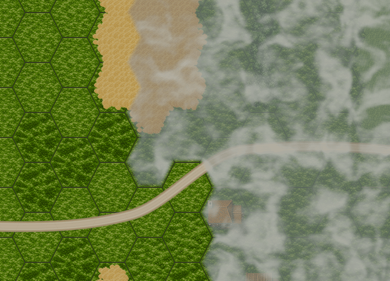

# Animated fog of war

Fog is a single map-wide overlay with slowly drifting billows and finer wisps. Its colors come from the approved neutral palette: `#747D79`, `#A2AAA1`, and `#D3D7CA`.

The visibility texture has one pixel per hex. Red marks authored map coverage, including river tiles; green marks cells outside the current player's LOS. The mask updates only when visibility changes. A lost view restores fog immediately. Enemy detection and unit visibility retain their existing rules.

The shader samples seamless noise in world coordinates, preserving cloud scale and position during camera movement and zoom. Neighboring obscured hexes share uninterrupted clouds. Only edges adjoining visible cells or the map boundary feather, over approximately 16 map pixels. Visible regions stay clear.

The overlay exposes opacity, feather width and wind velocity in the scene inspector. The existing fog debug toggle controls it. Visibility masks reset with each mission and are freed with the world.

Run `tests/fog_of_war_regression.tscn` for mask checks. Add `-- --render` for GPU coverage, seams, soft edges, animation, camera pan and zoom, and visibility changes at 64- and 128-pixel tile sizes in HDR and SDR. The LOS lifecycle regression covers real mission startup and returning to the menu.

Shader coordinates follow the [Godot 4.7 CanvasItem shader reference](https://docs.godotengine.org/en/4.7/tutorials/shaders/shader_reference/canvas_item_shader.html).
