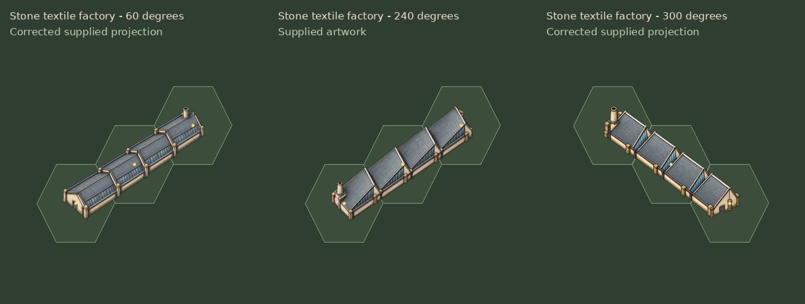

# Supplied textile factory views

These three supplied images update the existing stone textile factory in the
shared building layer. Its six orientations remain under **Patterns → 3-hex**.
The approved 0-degree view and the existing 120- and 180-degree views are retained.

| Supplied image | Orientation | Result |
| --- | --- | --- |
| `exec-09864b4b-6df8-4284-92bd-1b8e00c410f0.png` | 300 degrees | Projection corrected before installation |
| `ChatGPT Image Oct 15, 2026, 02_44_37 PM.png` | 60 degrees | Projection corrected before installation |
| `ChatGPT Image Oct 15, 2026, 02_44_18 PM.png` | 240 degrees | Supplied artwork used directly |

The original first two images have long axes that are too steep for the diagonal
hex rows. Uniform scaling and translation cannot put their complete silhouettes
inside three hexes while covering all three centers. The third image passes.
[initial_checks.json](initial_checks.json) records those results. The three
unchanged supplied originals are saved here as `supplied_<angle>.png`.

The built-in image generation tool corrected the two failing projections using
the supplied artwork and fixed-camera construction guides. The selected images
retain grey industrial saw-tooth roofs, pale stone masonry and upright chimneys.
[correction_prompts.json](correction_prompts.json) records the prompts and inputs;
[selected.json](selected.json) records selected sources and fitting results.

## Installed artwork

The final source images are saved under
`assets/tiles/buildings/multihex/three_hex_landmarks/source/supplied_textile_views/`.
The exporter reads each selected source from the generation manifest, preserving
the previous raw artwork. It applies uniform scaling and translation, with no
bitmap rotation, skewing or silhouette clipping.

The existing atlas path is updated in place:
`assets/tiles/buildings/multihex/three_hex_landmarks/perspective/building_stone_textile_factory_3hex.png`.
Its TileSet source and pattern identities remain the same. Existing placements
therefore show the updated artwork, and the layer still fills three cells with
stone defense and their corresponding LOS pixels.

All nonzero-alpha artwork stays inside the three occupied hexes with a one-pixel
inset. All four texels around each exact hex center have alpha at least 128/255.
The approved view's 296-pixel length in the hex ground plane is retained within
half a pixel. Hex outlines and yellow center markers appear only in previews.

The installed-artwork and placement/LOS Godot regression results are recorded
in [verification.json](verification.json).

Godot 4.7.2 passes 7,171 installed-artwork checks across 2,777,228 visible-pixel
placements and 28,286 placement/LOS checks. No failures. Pixel comparisons
confirm that the 0-, 120- and 180-degree atlas columns and all other buildings
are unchanged. All 36 selected source-image hashes match the generation manifest.
