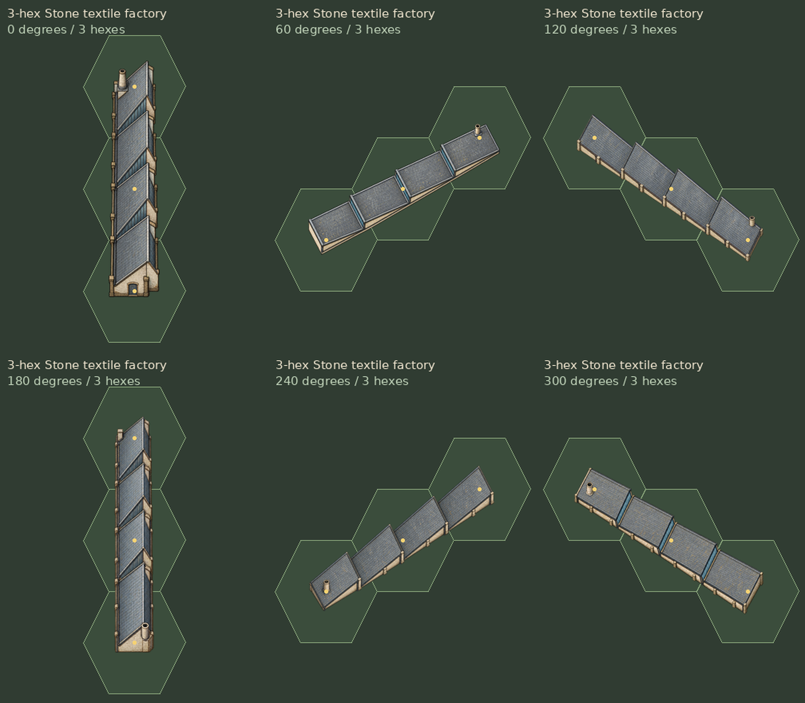

# Textile factory perspective correction

The supplied 0-degree view remains unchanged, including its complete atlas
column and LOS fragments. Five alternate views were redrawn with the built-in
image generation tool using a shared roof model and a fixed high camera.
Only the building's orientation changes. Saw-tooth bays keep their parallel
roof planes, masonry walls remain shallow, and the chimney stays upright.

The green hexes and yellow center markers are preview guides only. The shared
building layer already references the updated factory atlas at
`assets/tiles/buildings/multihex/three_hex_landmarks/perspective/building_stone_textile_factory_3hex.png`.
Existing factory placements use the replacement artwork automatically.

## Generation

- [direct_prompts.json](direct_prompts.json) contains the selected generation
  prompts and reference inputs.
- [selected.json](selected.json) records the five selected tool outputs and
  their fitting measurements. Copies of those outputs are kept under
  `assets/tiles/buildings/multihex/three_hex_landmarks/source/perspective/building_stone_textile_factory_3hex/`.
- `tools/art/textile_factory_view_guides.py` builds the flat-color construction
  guides from one roof model. These images are generation inputs, not sprites.
- [prompts.json](prompts.json) and [candidates.json](candidates.json) retain the
  initial, unselected generation attempt for reproducibility.

The exporter uses uniform scaling and translation. It never rotates the final
images or clips their silhouettes. Alternate views match the approved view's
296-pixel length in the hex ground plane, within half a pixel. All views remain
inside their three-hex union with a one-pixel inset, and all four texels around
each occupied hex center meet the required alpha threshold.

## Verification

Godot 4.7.2 passes 7,171 installed-artwork checks across 2,757,448 visible-pixel
placements, plus 28,286 placement, erasure, save/load and LOS checks. No failures.
These checks cover the entire six-building pack. Image hashes confirm that
only the factory atlas and its five alternate sprites changed; the 0-degree
factory artwork and the other five buildings are unchanged. All 36 selected
source-image hashes match the generation manifest.

[Full verification report](../verification.json).
