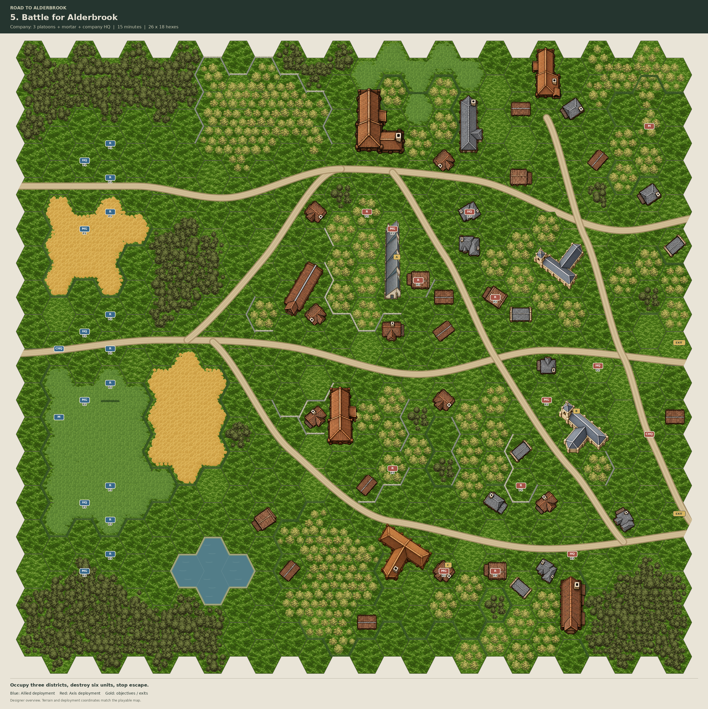

# Battle for Alderbrook: fields into town

The 26 × 18 map replaces the river barrier with a continuous approach from
farmland to village streets. The company can move between districts and commit
its reserve where the defense weakens. The existing force, campaign identity,
15-minute deadline and victory requirements remain in place.

The layout draws on the reference collection in
[ASL MMP boards](../../../art/asl_mmp_geo_boards/README.md):

- Boards 10 and 12: scattered buildings become a settlement beside branching roads.
- Board 6: an orchard and enclosed estate form a distinct defensive position.
- Boards 1 and 20: varied building footprints, road junctions and garden courts
  interrupt sight lines within town blocks.
- Board 4: hedged farm parcels leave gates and open approaches between them.

Only implemented terrain is used: open ground, crops, woods, orchards, roads,
water, timber/stone buildings, and hex-edge hedges/stone walls. Building roofs
retain brown for wood and grey for stone. The small southern pond has four
impassable hexes and does not separate the battlefield.

| District | Objective hex | Approach |
| --- | --- | --- |
| Orchard estate A | (14, 6) | Orchard concealment, farm lane and garden openings |
| Market hall B | (21, 10) | Main road, connecting streets and nearby house cover |
| Timber yard C | (16, 15) | Crop boundaries, barns and the southern orchard edge |

Coordinates are the editor's zero-based tile coordinates. The saved editor
layout supplies every building, its orientation and the objective locations.
All footprint cells retain their cover and LOS behavior. Road
corridors stay free of buildings. Barriers sit on hex sides and leave openings
toward roads and courtyards.

The designer image shows the saved placements. It is not a fog-of-war view.
Automated checks cover connectivity, deployments, supported terrain, material
cover, complete building footprints, edge ownership, cached LOS and live match
startup. A full balance playthrough remains outstanding.

## Village garden detail

The terrain pass preserves all 58 existing building cells, their material,
orientation and multihex footprints. It adds 27 orchard hexes in gardens around
the northern houses, western estate, eastern church, workshop courtyards, market
and southern yards. Six isolated woodland hexes at (12, 4), (22, 4), (24, 7),
(15, 10), (16, 12) and (18, 16) interrupt views through the village.

There are 37 additional hedge edges and nine stone-wall edges. They follow
garden boundaries, with openings toward the streets and courtyards. No new edge
crosses a road or divides a multihex building. Existing barriers are retained.
The ground, pond, roads, previous planting, deployments and objectives are
unchanged. Woods are present in both the terrain and blocking layers, using
matching canopy pixels for LOS and cover.

LOS has been rebuilt for the saved layout. A sample of 1,500 pairs checks cached
visibility, cover and hindrance against live calculations. Scene comparison
checks preserve the existing buildings and all non-tile scene properties.
Mission startup and enemy tactical planning pass all 23 checks at 60 fixed FPS.
[Terrain-pass verification](05_battle_for_alderbrook_detail_verification.json)
records the preservation and LOS results.

## Rebuild only this map

To reapply only the additive garden pass, run
`tools/campaigns/detail_alderbrook_village.tscn -- --apply --bake-los`.
It patches only the three affected tile-data lines, retains occupied cells and
existing barriers, and refreshes the map manifest. Without `--apply`, the tool
only exports an inspection snapshot to `/tmp/alderbrook-village-current.json`;
`--bake-los` can rebuild sight data independently. Repeated application makes no
additional placements. Render the refreshed manifest to update the designer image.

The following original builder regenerates the complete layout, including its
buildings, and should only be used when that full replacement is intended.

`tools/campaigns/alderbrook_village_layout.gd` defines roads, deployments,
objectives and briefing. `tools/campaigns/build_alderbrook_village.gd` defines
terrain parcels and building placement. Run the builder scene with
`-- --roads-only`, import its road atlas, then run it normally to save mission
five and its LOS. Use `-- --los-only` to preserve an edited map and rebuild only
its sight data. The regular campaign builder uses the same final-map layout.

Render the saved manifest with `tools/campaigns/render_alderbrook_maps.py`.
`tests/alderbrook_village_regression.tscn` checks the saved village and baked
sight data; `tests/alderbrook_campaign_regression.tscn -- --mission=5` exercises
the actual mission startup and enemy planning.
